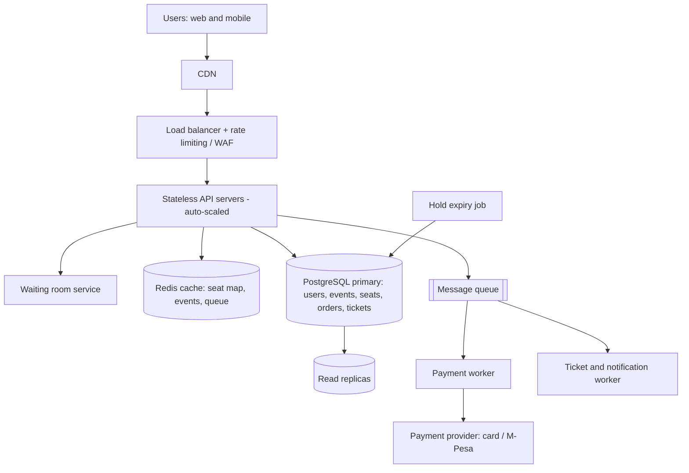

# TicketHub: Event Ticketing System Design

TicketHub is a website that sells tickets for concerts and events. This document follows the six-part framework: requirements, estimates, API, data model, architecture, trade-offs. It also explains how the design prevents two people from buying the same seat.

---

## 1. Requirements

### Functional requirements

1. Users can register, log in and log out.
2. Users can browse and search upcoming events (by name, date, city, category).
3. Users can view an event's details and its seat map with live availability.
4. Users can select seats and place a temporary **hold** on them (5 minutes).
5. Users can pay for held seats (card or mobile money, e.g. M-Pesa).
6. After successful payment, users receive tickets (with QR code) and can view them under "My tickets".
7. Held seats that are not paid for are released automatically when the hold expires.
8. Users can cancel a hold before paying.
9. Admins can create events, define seats/prices and see sales.

### Non-functional requirements

| Area | Requirement | Target |
|---|---|---|
| **Speed** | Browse events and event pages | p95 < 300 ms |
| | Seat map load | p95 < 500 ms |
| | Hold a seat | p95 < 1 s |
| **Correctness** | A seat is never sold to two people | 0 double-bookings (hard guarantee) |
| | A user is never charged without receiving a ticket, and never receives a ticket without paying | Orders and payments always reconcile |
| | Held seats always return to the pool when a hold expires | 100% |
| **Fairness** | Everyone who joins a big sale is served in arrival order | First-come, first-served virtual waiting room |
| | No one can hoard seats | Max 4 seats per order, one active hold per user per event, bot protection (CAPTCHA, rate limits) |
| **Availability** | Site stays up during a big sale | 99.9% overall; browsing keeps working even if payments are slow |
| **Scalability** | Handle ~500x normal load on a single event for 10 minutes | See section 2 |
| **Security** | Payments and personal data protected | HTTPS everywhere, no card data stored (payment provider tokens only), hashed passwords |
| **Durability** | Paid orders are never lost | Replicated database with backups |

---

## 2. Estimates

### Given facts

- 2,000,000 registered users
- 50,000 visitors on a normal day, each viewing 10 pages
- 5,000 tickets sold on a normal day
- Big sale: 200,000 people try to buy 20,000 seats in the first 10 minutes

### Normal day

| Quantity | Calculation | Result |
|---|---|---|
| Page views per day | 50,000 × 10 | 500,000 |
| Average requests per second | 500,000 ÷ 86,400 s | ≈ 6 req/s |
| Busy-hour peak (assume 10× average) | 6 × 10 | ≈ 60 req/s |
| Visitors arriving per second (average) | 50,000 ÷ 86,400 | ≈ 0.6 users/s |
| Tickets sold per second (average) | 5,000 ÷ 86,400 | ≈ 0.06 tickets/s |
| Read : write ratio | 500,000 views vs 5,000 sales | ≈ 100 : 1 (read-heavy) |

A normal day is easy: one small database and a couple of app servers can handle it.

### Big sale (popular concert goes on sale)

Assumptions: each of the 200,000 users makes about 10 requests in the window (load page, join queue, poll status, load seat map, hold, pay), and about 3 hold attempts each because seats are taken by others.

| Quantity | Calculation | Result |
|---|---|---|
| Users arriving per second | 200,000 ÷ 600 s | ≈ 333 users/s |
| Total requests | 200,000 × 10 | 2,000,000 |
| Requests per second | 2,000,000 ÷ 600 s | ≈ 3,300 req/s |
| Seat hold attempts | 200,000 × 3 = 600,000 ÷ 600 s | ≈ 1,000 attempts/s |
| Tickets sold | 20,000 in 10 min | ≈ 33 tickets/s |
| Demand vs supply | 200,000 ÷ 20,000 | 10 people per seat (90% will fail) |

### Comparison

| Metric | Normal day | Big sale (10 min) | Increase |
|---|---|---|---|
| Users arriving per second | 0.6 | 333 | ≈ 575× |
| Requests per second | 6 (60 busy hour) | 3,300 | ≈ 575× (≈ 55× vs busy hour) |
| Tickets sold per second | 0.06 | 33 | ≈ 575× |
| Tickets in total | 5,000 per day | 20,000 in 10 min | 4× a whole normal day, in 0.7% of the time |
| Nature of traffic | Read-heavy, spread out | Write-heavy contention on the same 20,000 rows | Many people fighting over the same seats |

**Conclusion:** the problem is not the average, it is the spike and the contention. Everyone wants the same event and the same best seats at the same second. We must design for the peak, protect the database from the crowd, and make seat ownership strictly correct.

### Storage (quick check)

- Orders: 5,000/day × 365 ≈ 1.8 million/year × ~1 KB ≈ 2 GB/year.
- Seats: assume 500 events/year × 10,000 seats average = 5 million rows × ~200 B ≈ 1 GB/year.
- Storage is small. Throughput and contention are the real challenges, not size.

---

## 3. API

Base URL: `https://api.tickethub.example/v1`. All write endpoints require `Authorization: Bearer <token>`.

| # | Purpose | Method and path | Request | Response |
|---|---|---|---|---|
| 1 | Browse events | `GET /events?city=&category=&date=&page=` | query params | `200` list of events (id, name, venue, date, min price, status) |
| 2 | Event details | `GET /events/{event_id}` | none | `200` event object |
| 3 | View seats | `GET /events/{event_id}/seats?section=` | none | `200` list of seats (seat_id, section, row, number, price, status: AVAILABLE / HELD / SOLD) |
| 4 | Join waiting room (big sales) | `POST /events/{event_id}/queue` | none | `202` `{queue_position, estimated_wait}`; later `GET /events/{event_id}/queue/me` returns `{status: WAITING/ADMITTED, admit_token}` |
| 5 | Hold seats | `POST /events/{event_id}/holds` | `{seat_ids: [..]}` + `admit_token` | `201` `{hold_id, expires_at}`; `409` if any seat is already taken |
| 6 | Release hold | `DELETE /holds/{hold_id}` | none | `204` |
| 7 | Pay | `POST /holds/{hold_id}/pay` | `{payment_method, idempotency_key}` | `201` `{order_id, status: PAID}`; `402` payment failed; `410` hold expired |
| 8 | View my tickets | `GET /me/tickets` | none | `200` list of tickets (ticket_id, event, seat, QR code) |
| 9 | Order details | `GET /orders/{order_id}` | none | `200` order with tickets and payment status |

Notes:

- `idempotency_key` on `/pay` means a double-click or retry never charges twice.
- `POST /holds` is all-or-nothing: either every requested seat is held, or none is.
- `GET /events/{id}/seats` is served from cache (see architecture); the real check happens at hold time.

---

## 4. Data model

```sql
CREATE TABLE users (
  user_id        BIGSERIAL PRIMARY KEY,
  email          VARCHAR(255) NOT NULL UNIQUE,
  password_hash  VARCHAR(255) NOT NULL,
  full_name      VARCHAR(120) NOT NULL,
  phone          VARCHAR(20),
  created_at     TIMESTAMPTZ NOT NULL DEFAULT now()
);

CREATE TABLE events (
  event_id       BIGSERIAL PRIMARY KEY,
  name           VARCHAR(200) NOT NULL,
  venue          VARCHAR(200) NOT NULL,
  city           VARCHAR(100) NOT NULL,
  category       VARCHAR(50)  NOT NULL,
  starts_at      TIMESTAMPTZ  NOT NULL,
  on_sale_at     TIMESTAMPTZ  NOT NULL,
  status         VARCHAR(20)  NOT NULL DEFAULT 'SCHEDULED'
);

CREATE TABLE seats (
  seat_id          BIGSERIAL PRIMARY KEY,
  event_id         BIGINT NOT NULL REFERENCES events(event_id),
  section          VARCHAR(20) NOT NULL,
  row_label        VARCHAR(5)  NOT NULL,
  seat_number      INT NOT NULL,
  price            NUMERIC(10,2) NOT NULL CHECK (price >= 0),
  status           VARCHAR(10) NOT NULL DEFAULT 'AVAILABLE'
                   CHECK (status IN ('AVAILABLE','HELD','SOLD')),
  held_by          BIGINT REFERENCES users(user_id),
  hold_expires_at  TIMESTAMPTZ,
  UNIQUE (event_id, section, row_label, seat_number)   -- a physical seat exists once per event
);

CREATE TABLE orders (
  order_id      BIGSERIAL PRIMARY KEY,
  user_id       BIGINT NOT NULL REFERENCES users(user_id),
  event_id      BIGINT NOT NULL REFERENCES events(event_id),
  total_amount  NUMERIC(10,2) NOT NULL,
  status        VARCHAR(10) NOT NULL CHECK (status IN ('PENDING','PAID','FAILED','REFUNDED')),
  idempotency_key VARCHAR(64) NOT NULL UNIQUE,
  payment_ref   VARCHAR(100),
  created_at    TIMESTAMPTZ NOT NULL DEFAULT now()
);

CREATE TABLE tickets (
  ticket_id   BIGSERIAL PRIMARY KEY,
  order_id    BIGINT NOT NULL REFERENCES orders(order_id),
  seat_id     BIGINT NOT NULL UNIQUE REFERENCES seats(seat_id),  -- the last line of defence
  qr_code     VARCHAR(100) NOT NULL UNIQUE,
  issued_at   TIMESTAMPTZ NOT NULL DEFAULT now()
);

CREATE INDEX idx_seats_event_status ON seats(event_id, status);
CREATE INDEX idx_orders_user ON orders(user_id);
```

### Relationships

- One **user** has many **orders** (1 : N).
- One **event** has many **seats** (1 : N) and many **orders** (1 : N).
- One **order** has many **tickets** (1 : N): one ticket per seat bought.
- One **seat** has at most one **ticket** (1 : 0..1), enforced by `UNIQUE (seat_id)` on `tickets`.
- A **seat** may be temporarily held by one **user** (`held_by`).

```
users 1───N orders 1───N tickets N───1 seats N───1 events
                 N──────────────────────────────────1
```

---

## 5. How double-booking is prevented

The rule: **the database, not the application code, decides who gets the seat**, using three layers. Even if one layer fails, the next one stops a double sale.

### Layer 1: Atomic conditional update (the hold)

The check ("is the seat free?") and the change ("take it") happen in **one SQL statement**, so there is no gap between them:

```sql
UPDATE seats
SET status = 'HELD', held_by = :user_id, hold_expires_at = now() + interval '5 minutes'
WHERE seat_id = :seat_id
  AND ( status = 'AVAILABLE'
        OR (status = 'HELD' AND hold_expires_at < now()) );
```

- If the statement updates **1 row**, the user got the seat.
- If it updates **0 rows**, someone else got there first, and the API returns `409 Conflict`.

Why this works: the database takes a row lock on the seat while updating. If two users run this at the same moment, one runs first and flips the status to `HELD`; the second then re-checks the `WHERE` condition, finds the seat no longer `AVAILABLE`, and updates 0 rows. A naive version (`SELECT` to check, then `UPDATE` in app code) has a race: both users read "available" and both write. Combining check and write in one statement removes that race.

For multi-seat holds, all seats are updated inside **one transaction**; if the number of rows updated is less than the number requested, the transaction is **rolled back** (all-or-nothing) so no one is left with half a booking. Seats are always locked in ascending `seat_id` order to avoid deadlocks between two users choosing overlapping seats.

### Layer 2: Transaction at payment time

When payment succeeds, a single transaction finalises the sale:

```sql
BEGIN;
-- lock this user's held seats; fail if the hold is gone or expired
SELECT seat_id FROM seats
 WHERE seat_id = ANY(:seat_ids) AND held_by = :user_id
   AND status = 'HELD' AND hold_expires_at > now()
 FOR UPDATE;
-- if count <> number of seats: ROLLBACK and refund

UPDATE seats SET status = 'SOLD', hold_expires_at = NULL WHERE seat_id = ANY(:seat_ids);
INSERT INTO orders (...) VALUES (... 'PAID' ...);
INSERT INTO tickets (order_id, seat_id, qr_code) VALUES (...);
COMMIT;
```

Either the seat status, order and tickets are **all** written, or **none** are (atomicity). If the hold expired while the user was paying, the transaction rolls back and the payment is refunded, so nobody pays for a seat they do not get.

### Layer 3: Constraints (last line of defence)

- `tickets.seat_id` is `UNIQUE`: the database physically cannot store two tickets for the same seat, even if there were a bug in the code above. The second insert fails and the transaction rolls back.
- `CHECK (status IN (...))` and foreign keys keep data valid.
- `orders.idempotency_key` is `UNIQUE`, so a retried payment request cannot create a second order.

### Expiry of holds

A background job runs every 30 seconds and resets expired holds to `AVAILABLE`. Even if the job is late, the hold query in Layer 1 treats an expired hold as available, so correctness does not depend on the job.

### Result

Two people clicking the same seat at the same millisecond: exactly one gets `201`, the other gets `409`. Two people paying for the same seat is impossible because only the holder can complete Layer 2, and Layer 3 blocks a duplicate ticket regardless.

---

## 6. Architecture



### Components

| Component | What it does and why it is there |
|---|---|
| **CDN** | Serves static files (images, JS, CSS) and cached event pages from locations close to users. Takes most of the read traffic away from our servers, which matters because browsing is ~100× more common than buying. |
| **Load balancer + WAF / rate limiter** | Spreads requests across API servers and blocks bots and abusive clients (per-IP and per-user limits, CAPTCHA at queue entry). Supports fairness. |
| **API servers (stateless)** | Run the endpoints in section 3. Because they keep no state, we can add more servers in minutes before a big sale (auto-scaling) and any server can handle any request. |
| **Waiting room service** | For big sales, users join a first-come-first-served queue instead of hitting the seat endpoints all at once. We admit users in batches (for example 2,000 at a time) with a signed `admit_token`. This turns a 200,000-person spike into a steady, controlled flow, and it is what makes the sale fair. |
| **Redis cache** | Stores the event list, seat-map snapshots (refreshed every 1-2 seconds), queue positions and rate-limit counters. Protects the database from repeated seat-map reads. The cache is **never** the source of truth for seat ownership. |
| **PostgreSQL primary** | The single source of truth for users, events, seats, orders and tickets. All holds and sales go through it, using the transactions and constraints in section 5. |
| **Read replicas** | Serve browsing, search and "My tickets" so the primary only handles writes (holds and sales). |
| **Message queue** | Decouples slow work from the user request: payment confirmation callbacks and ticket e-mails/SMS are processed asynchronously and can be retried if they fail. |
| **Payment worker + payment provider** | Talks to the card/M-Pesa provider, uses the idempotency key, and completes the Layer 2 transaction when payment is confirmed. |
| **Notification worker** | Sends ticket e-mail/SMS with the QR code after the order is `PAID`. |
| **Hold expiry job** | Periodically releases expired holds back to `AVAILABLE`. |

### How it survives the big sale

1. **Before the sale:** the event page and static assets are cached on the CDN; API servers are pre-scaled up (we know the sale time, `on_sale_at`) and the seat map is pre-warmed in Redis.
2. **At the sale:** 200,000 people arrive at ~333/s. The waiting room absorbs them cheaply (a queue position in Redis, not a database write), so the database never sees the full crowd.
3. **Admitted users** (a few thousand at a time) load the seat map from Redis and send hold requests. The database sees at most ~1,000 hold attempts/s, which a single well-indexed primary can handle because each is a single-row indexed update.
4. **Contention is safe:** when many users go for the same seat, the atomic update makes one win and the rest receive a quick `409`, and the UI asks them to pick another seat. No double sales, no long locks.
5. **Payments are asynchronous and bounded:** at most 20,000 holds can ever exist, and each expires in 5 minutes, so abandoned seats flow back to the next people in the queue.
6. **Sold out:** once all 20,000 seats are `SOLD`, the event is marked sold out in the cache, and remaining queue users are told immediately instead of waiting, which stops useless traffic.
7. **Failure isolation:** if the payment provider is slow, holds and browsing still work; payments queue up and retry. If a read replica fails, traffic moves to another replica.

---

## 7. Trade-offs

### Trade-off 1: Seat holds with a timer (5 minutes) vs. no holds

- **Chosen:** hold seats for 5 minutes while the user pays.
- **Benefit:** users never pay for a seat and then find it gone; a better experience and no refunds from lost races.
- **Cost:** abandoned holds make seats look unavailable to others for up to 5 minutes, which can slow a sale and let bots or hoarders block seats. A longer hold is friendlier but ties up inventory; a shorter one is fairer to the crowd but stressful for slow payers (especially on mobile money).
- **Mitigation:** 5-minute limit, max 4 seats, one active hold per user per event, and the expiry job.

### Trade-off 2: Strong consistency for seat ownership vs. speed of the seat map

- **Chosen:** the database is strongly consistent for holds and sales; the seat map shown to users comes from a cache refreshed every 1-2 seconds.
- **Benefit:** the database is protected from thousands of seat-map reads per second, so it stays fast for the writes that matter.
- **Cost:** the seat map can be slightly stale, so a user may click a seat that was just taken and get a `409`.
- **Why acceptable:** a stale display is a small annoyance; selling a seat twice is a serious failure. We spend consistency where correctness matters and use eventual consistency where it does not.

### Trade-off 3: Waiting room (fairness) vs. simplicity and user experience

- **Chosen:** a virtual queue for high-demand events.
- **Benefit:** fair first-come-first-served access, protects the system from the spike, and lets us admit only as many users as the system can handle.
- **Cost:** extra component to build and operate; users must wait and may feel frustrated; a sold-out message can arrive after a long wait.
- **Mitigation:** show queue position and estimated wait, and only enable the waiting room for events that expect high demand.

### Trade-off 4: Atomic SQL update (optimistic) vs. explicit locks or a distributed lock

- **Chosen:** a single conditional `UPDATE` for holds, and `SELECT ... FOR UPDATE` only at payment.
- **Benefit:** simple, fast, no separate lock service to fail, and the database guarantees correctness.
- **Cost:** all hold writes hit one PostgreSQL primary, which limits horizontal scaling. If one event grew far beyond 20,000 seats, we would need to shard seats by `event_id`.
- **Why acceptable:** about 1,000 indexed single-row updates per second is well within one primary's capacity for our estimated peak.